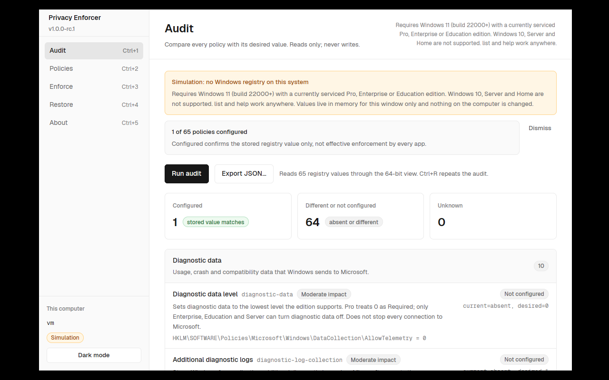
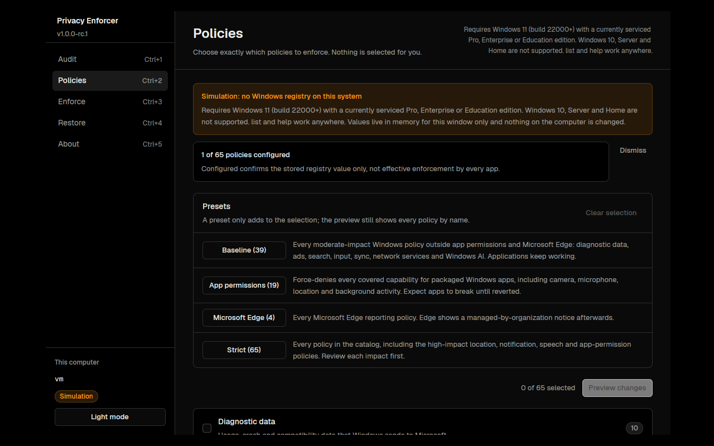

# Privacy Enforcer

[](https://github.com/Master0fFate/PrivacyEnforcerPS/actions/workflows/ci.yml)
[](LICENSE)

An audit-first, reversible privacy policy tool for Windows 11, written in Rust. It ships as a
command line (`pef`) and a native desktop app (`pef-gui`) built on
[GPUI Fast](https://github.com/longbridge/gpui-fast) with an interface in the spirit of
Vercel's Geist design system.

Privacy Enforcer reads and writes documented Windows policy values below
`HKEY_LOCAL_MACHINE`. It never selects anything for you, previews every change before it
asks for a typed confirmation, saves and verifies a recovery file before the first write,
reads every write back, and refuses to overwrite a value that something else changed in the
meantime.

<p align="center">
  
</p>
<p align="center">
  
</p>

## Contents

- [What it does](#what-it-does)
- [What it refuses to do](#what-it-refuses-to-do)
- [Requirements](#requirements)
- [Install](#install)
- [Command line](#command-line)
- [Desktop app](#desktop-app)
- [Policy catalog](#policy-catalog)
- [Recovery files](#recovery-files)
- [Safety model](#safety-model)
- [Building and testing](#building-and-testing)
- [Project layout](#project-layout)
- [History](#history)
- [License](#license)

## What it does

- **Audits** 65 documented policies and reports each as `Configured`,
  `DifferentOrNotConfigured` or `Unknown`. Auditing reads only and never needs elevation.
- **Previews** exactly what an enforcement would change: the policy, the value it holds now
  and the value it would get.
- **Enforces** an explicit selection after you type `ENFORCE`, writing a recovery file first
  and verifying every registry write.
- **Restores** a recovery file after you type `RESTORE`, walking the plan in reverse and
  skipping entries that already hold their original value.

`Configured` confirms the stored registry value only. It is not proof of effective
enforcement: MDM or Group Policy can override or reapply values, per-app exceptions exist,
and classic desktop applications are not covered by the app-permission policies.

## What it refuses to do

- It does not disable Microsoft Defender, Windows Update, User Account Control, event logs,
  scheduled tasks, services, authentication or network connectivity.
- It does not guarantee anonymity, eliminate all telemetry, clear past cloud data or isolate
  applications with firewall rules.
- It does not auto-update, install persistence, download blocklists, phone home, collect
  secrets or run shell commands.
- It never takes a registry path from a file: recovery files carry policy IDs that are
  matched against the built-in catalog.

## Requirements

| | Requirement |
|---|---|
| Operating system | Windows 11 (build 22000 or later), Professional, Enterprise or Education editions, including the N, Workstation and LTSC (`EnterpriseS`) variants |
| Elevation | None for `list`, `audit` and previews. An administrator terminal (or an elevated `pef-gui`) for apply and restore |
| Other systems | Windows 10, Server and Home are refused for policy access. `pef list` and `pef help` work anywhere; `pef-gui` opens in a labelled in-memory simulation on systems without a supported registry |

The gate checks the build number and an explicit edition allow-list. It does not determine
whether your edition is still serviced; check
[Windows release health](https://learn.microsoft.com/en-us/windows/release-health/).

## Install

Download the archive for your platform from the
[releases page](https://github.com/Master0fFate/PrivacyEnforcerPS/releases), compare its
SHA-256 with the published checksum, and unpack it anywhere. Each archive holds `pef`,
`pef-gui`, this README, the changelog and the licenses. Binaries are unsigned, so Windows may
show an unrecognised-publisher warning.

Start with something that cannot change anything:

```powershell
.\pef.exe list
.\pef.exe audit
```

To build from source instead, see [Building and testing](#building-and-testing).

## Command line

```
pef list [--select ID,ID] [--preset NAME,NAME] [--json]
pef list --presets [--json]
pef audit [--select ID,ID] [--preset NAME,NAME] [--json]          (default)
pef enforce (--select ID,ID | --preset NAME,NAME) [--apply --backup NEW_FILE.json]
pef restore --backup FILE.json [--apply]
pef help | version
```

No arguments means `audit`. Without `--apply`, `enforce` and `restore` only preview.
`--select` takes catalog IDs; `--preset` takes preset names; both may be combined and the
result is shown in catalog order. Unknown IDs, repeated options and read-only commands given
write options are all rejected before any platform access.

### A typical session

```powershell
# What is there, and what would it do?
pef list --preset baseline
pef audit --json

# Preview in a normal terminal. Nothing is written.
pef enforce --select advertising-id,clipboard-history,recall-snapshots

# Apply in an administrator terminal, with a NEW file in an existing private folder.
pef enforce --select advertising-id,clipboard-history,recall-snapshots --apply --backup C:\PrivateBackups\privacy-before.json
#   DRY RUN output is repeated as "Requested operation", then:
#   Type ENFORCE to confirm only these policies: ENFORCE

# Later: check the recovery file, then revert in an administrator terminal.
pef restore --backup C:\PrivateBackups\privacy-before.json
pef restore --backup C:\PrivateBackups\privacy-before.json --apply
#   Type RESTORE to confirm only these policies: RESTORE
```

Redirected standard input cannot approve a write; the confirmation must be typed in a
terminal. Repeating an enforcement whose values already match writes nothing and needs no
new backup file.

### Exit codes

| Code | Meaning |
|---|---|
| `0` | Successful read, preview or write, or a cancellation at the prompt |
| `1` | Invalid input, unsupported platform, or an operation that stopped. The message says whether anything was written |
| `2` | The audit contains at least one `Unknown` value |

## Desktop app

`pef-gui` offers the same workflow with five screens, reachable from the sidebar or with
`Ctrl+1` to `Ctrl+5`:

| Screen | What it does |
|---|---|
| **Audit** | Runs the read-only audit (`Ctrl+R`), shows counts per state and every policy grouped by area, and exports the report as JSON |
| **Policies** | The catalog with a checkbox per policy, per-area select-all, impact badges, the audit state, and a link to each Microsoft reference. Presets add to the selection |
| **Enforce** | Four steps: review the selection, preview the plan, choose a new recovery file, enforce. The button stays disabled until there is a non-empty plan and the window is elevated |
| **Restore** | Open or type the path of a recovery file, validate it against this computer and the catalog, review the entries, restore |
| **About** | Boundaries, keyboard shortcuts and credits |

Enforce and restore open a dialog that asks you to type `ENFORCE` or `RESTORE`; `Enter`
confirms, `Escape` cancels. A window that is not elevated can audit and preview but not
write; the sidebar badge shows which case you are in. `Ctrl+Shift+L` switches between the
light and dark palettes and `Ctrl+Q` quits.

On a system without a supported Windows registry (Linux, macOS, Windows 10 or Home) the app
opens in a clearly labelled **simulation**: values live in memory for that window and nothing
on the computer changes. This is how the interface is developed and tested.

## Policy catalog

Every entry maps to one `DWORD` under `HKEY_LOCAL_MACHINE\SOFTWARE\Policies\...`, carries an
impact statement and a Microsoft reference, and has a stable ID. Run `pef list` for the full
text or `pef list --json` for machine-readable output.

| Area | Policies | Examples |
|---|---|---|
| Diagnostic data | 10 | `diagnostic-data`, `error-reporting`, `ceip`, `feedback-notifications` |
| Personalization & ads | 4 | `advertising-id`, `consumer-features`, `windows-tips` |
| Search | 5 | `search-web-results`, `search-highlights`, `cortana` |
| Input & speech | 5 | `online-speech`, `typing-data-collection`, `speech-model-updates` |
| Location | 2 | `location-platform`, `find-my-device` |
| App permissions | 19 | `app-camera`, `app-microphone`, `app-location`, `app-background` |
| Activity & sync | 10 | `activity-feed`, `clipboard-history`, `settings-sync`, `phone-link` |
| Network services | 3 | `font-providers`, `delivery-optimization-p2p`, `device-metadata` |
| Windows AI | 3 | `recall-snapshots`, `recall-enablement`, `click-to-do` |
| Microsoft Edge | 4 | `edge-personalization-reporting`, `edge-search-suggestions` |

Eight policies are marked **high impact** because they can break calls, recording,
dictation, notifications, location features or background apps until reverted:
`online-speech`, `location-platform`, `app-camera`, `app-microphone`, `app-location`,
`app-background`, `app-screen-capture` and `cloud-notifications`.

### Presets

A preset is only a shorthand for an explicit list. The preview always shows every policy it
expands to, and the typed confirmation is still required.

| Preset | Policies | Covers |
|---|---|---|
| `baseline` | 39 | Every moderate-impact Windows policy outside app permissions and Edge. Applications keep working |
| `app-permissions` | 19 | Force-denies every covered capability for packaged Windows apps. Expect apps to break until reverted |
| `edge` | 4 | Microsoft Edge reporting. Edge then shows a managed-by-organization notice |
| `strict` | 65 | The whole catalog, including every high-impact policy |

Some policies are documented by Microsoft for Enterprise and Education only and may be
ignored on Pro; their impact text says so. Policy mappings were checked against the
[Policy CSP reference](https://learn.microsoft.com/en-us/windows/client-management/mdm/policy-csp-privacy),
the [Microsoft Edge policy reference](https://learn.microsoft.com/en-us/deployedge/microsoft-edge-policies)
and Microsoft's
[guide to managing connections to Microsoft services](https://learn.microsoft.com/en-us/windows/privacy/manage-connections-from-windows-operating-system-components-to-microsoft-services).

## Recovery files

A recovery file is pretty-printed JSON of at most 64 KiB:

```json
{
  "Version": 1,
  "Machine": "DESKTOP-EXAMPLE",
  "Created": "2026-10-21T00:45:00Z",
  "Changes": [
    { "Id": "advertising-id", "Before": { "Exists": false, "Value": 0 }, "Desired": 1 }
  ]
}
```

- It must be a **new** file in an **existing** folder; the tool never overwrites an earlier
  recovery point and never creates folders or changes permissions.
- Keep it private. It contains the computer name and previous values, not credentials. Avoid
  public shares, cloud-synced folders and files you did not create yourself.
- It is neither signed nor encrypted. The machine-name check is a guard against mistakes,
  not an identity proof.
- Restore validates the version, the machine, every ID against the catalog, duplicate
  entries and desired values. Unknown or duplicate JSON fields are rejected.
- Files written by the earlier .NET release use the same layout and restore unchanged.
- Restore recovery files in reverse chronological order if you applied several.

## Safety model

The rules below are the test suite's executable claims, not aspirations.

1. **Audit and preview never write.** The engine's read-only paths take `&self`; the
   in-memory store counts writes and the tests assert zero.
2. **Everything is read before anything is written.** An unreadable value, or a registry
   value of an unexpected type, fails the whole plan instead of being skipped or converted.
3. **The recovery file comes first.** The complete plan is created exclusively, flushed to
   disk and read back before the first registry write. If that fails, nothing is written.
4. **Every write is verified.** Each value is re-read after the write; a mismatch stops the
   operation with a message that points at the recovery file.
5. **Nothing is overwritten blindly.** Before writing, every value must still equal what the
   plan recorded; during restore it must equal either the original or the enforced value.
   Anything else is a conflict and the operation stops before the first write.
6. **Restore is idempotent.** It walks the plan in reverse, skips entries already restored
   and tolerates a plan that was only partially applied.
7. **Writes need a person.** Elevation, a real terminal (or the app's dialog) and the exact
   word `ENFORCE` or `RESTORE` are required; a preset or a script cannot bypass the preview.

Apply and restore are not atomic transactions. A power loss, permission failure or concurrent
writer can leave a partial operation; the recovery file and the audit are how you recover.
There is a small window between checking a value and writing it, so do not run several
policy tools at once.

## Building and testing

The workspace pins Rust 1.98.1 through `rust-toolchain.toml`; `rustup` installs it on first
use. On Linux the desktop app needs the usual GPUI development packages (see
[`ci.yml`](.github/workflows/ci.yml) for the exact `apt` list).

```sh
cargo build --release                 # target/release/pef and target/release/pef-gui
cargo test --workspace                # everything below
cargo clippy --workspace --all-targets
cargo run -p pef-cli -- list          # read-only, works on any OS
cargo run -p pef-gui                  # opens in simulation off Windows
```

The suite covers:

- the engine rules above, driven against an in-memory store with failure injection, including
  mid-apply changes, read-back failures, partial applies and repeated restores;
- the recovery-file format: round trips, size limit, duplicate, missing and unknown fields,
  timestamps, and files written by the .NET release;
- the argument grammar and every fail-closed rule;
- the command line end to end with a fake host: elevation, terminal detection, the typed
  word, cancellation, exit codes and the text and JSON output;
- the desktop session model, the design tokens (both palettes must meet WCAG contrast
  targets) and the views themselves through GPUI's headless test context, including the
  enforce and restore flows through the confirmation dialog.

CI runs the suite on Linux and Windows and type-checks the Windows target from Linux. A
tagged push builds release archives with checksums for both platforms. None of this applies
policies to a runner: real policy behaviour, propagation, sign-out and app compatibility
still need the [manual validation checklist](docs/WINDOWS-VALIDATION.md) on a disposable
Windows 11 VM before a stable release.

## Project layout

```
crates/pef-core       Catalog, presets, models, backup format, argument grammar, engine. No platform access.
crates/pef-platform   Windows registry store (64-bit view), OS gate, elevation check, machine name.
crates/pef-cli        The `pef` binary: a testable `run` function behind a small host abstraction.
crates/pef-gui        The `pef-gui` binary: session model, theme tokens, components, views, embedded Geist fonts.
docs/                 Validation checklist and screenshots.
BACKUP/               Archived PowerShell, C# console and C#/.NET solution implementations. Not built.
```

## History

Privacy Enforcer started as a PowerShell script, became a single-file C# console tool, then an
audit-first C#/.NET 10 solution with a seven-policy catalog, and is now this Rust workspace.
Each earlier implementation is kept under `BACKUP/` for reference only.

## License

Privacy Enforcer is released under the [MIT License](LICENSE). The desktop app embeds the
Geist typeface by Vercel under the [SIL Open Font License 1.1](crates/pef-gui/assets/fonts/OFL.txt)
and builds on GPUI Fast and GPUI, both Apache-2.0.
